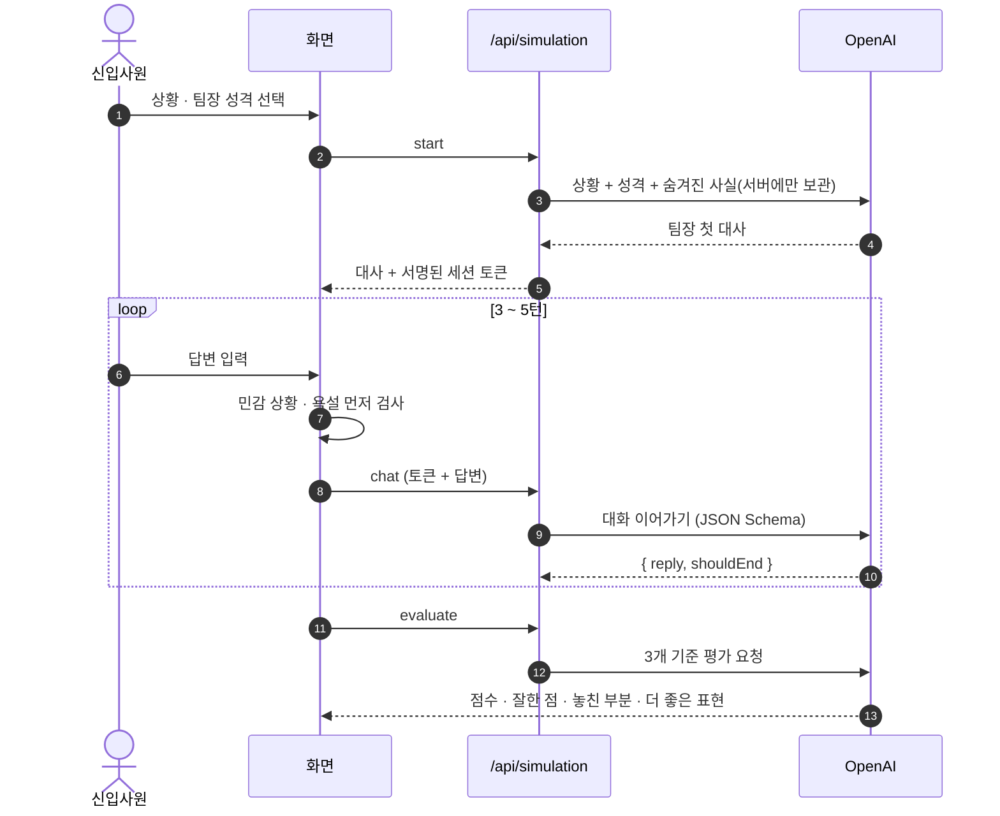
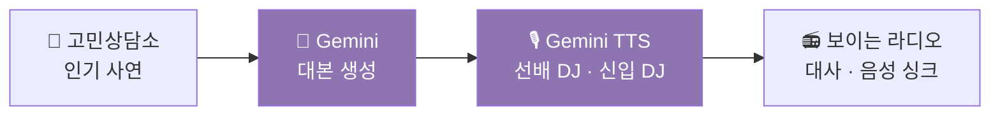
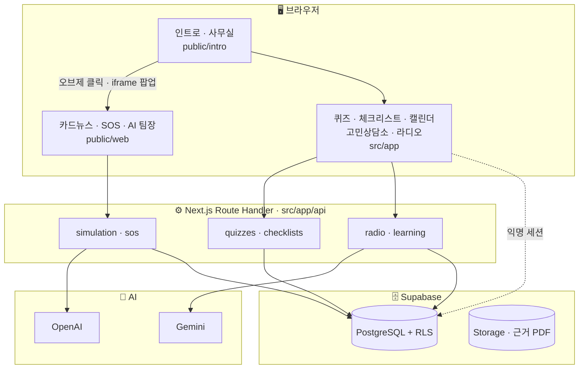
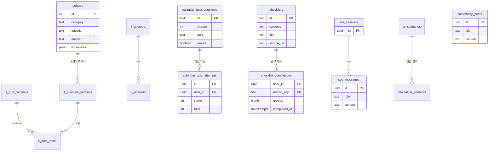

<div align="center">


<br>

### 🏝️ 회사라는 낯선 섬에 표류한 신입사원, 오늘도 무사히 퇴근할 수 있을까?

사무실 책상 위 물건을 하나씩 눌러 보며 **배우고 · 묻고 · 연습하고 · 실천하는** 회사생활 가이드

<br>


<br>


**동아일보 부트캠프 · [미디어 프론티어] 생성형 AI 마스터 클래스** &nbsp;|&nbsp; 2026.09.28 – 11.09 &nbsp;|&nbsp; 팀 4명

</div>

<br>

<div align="center">

<br>
<sub>▲ 인트로부터 퇴근까지, 젠지 표류기의 하루</sub>
</div>

<br>

## 📌 목차

<br>

| | | |
| :-- | :-- | :-- |
| 01 [개요](#-개요) | 05 [주요 기능 및 기술적 특징](#-주요-기능-및-기술적-특징) | 09 [실행 방법](#-실행-방법) |
| 02 [기획 배경](#-기획-배경) | 06 [기술적 의사결정](#-기술적-의사결정) | 10 [기능 구현](#-기능-구현) |
| 03 [기술 스택](#-기술-스택) | 07 [프로젝트 구조](#-프로젝트-구조) | 11 [개선사항](#-개선사항) |
| 04 [핵심 기능](#-핵심-기능) | 08 [데이터베이스 구조](#-데이터베이스-구조) | 12 [팀 & 기여](#-팀--기여) |


<br>

## 🚀 배포 주소

<br>

[👉 젠지 표류기 바로가기](https://genz-project-one.vercel.app)

<br>

## 🧭 개요

> **신입사원이 가상 사무실의 물건을 눌러 카드뉴스 · 퀴즈 · 체크리스트 · AI 팀장으로 회사생활을 익히는 웹서비스**

<table>
<tr>
<td width="58%"></td>
<td>

**대상**<br>첫 출근을 앞둔, 또는 갓 입사한 젊은 신입사원

**콘텐츠 – 7개 주제**<br>
`조직 이해·적응` `업무 절차·기준` `질문·소통`<br>
`협업·동료 존중` `직장 관계·예절` `근무·재택 수칙` `공용 공간·비품`

**흐름**<br>인트로 → 사무실 → 8개 오브제 기능 → 퇴근 아웃트로

</td>
</tr>
</table>

<br>

## 💡 기획 배경

| 문제 | 접근 | 전환점 |
| :-- | :-- | :-- |
| 질문 타이밍, 근태 규정, 회의 예절처럼 **“다들 아는 것”** 을 신입은 혼자 찾아야 한다 | **One Source Multi Use** — 동아일보 기사와 공식 자료 하나를 카드뉴스 · 퀴즈 · 라디오 · 체크리스트로 재가공 | **10/08 멘토 피드백** — 커뮤니티를 ‘고민상담소’로 바꾸고, 사무실을 클릭해 탐험하는 UX로 전면 개편 |

> [!NOTE]
> **🔓 로그인 페이지를 따로 만들지 않았습니다.**<br>
> 공공기관에 배포하거나 회사 안에서 **누구나 바로 쓸 수 있도록** 하기 위해서입니다.
> 대신 Supabase **익명 세션 + RLS** 로, 회원가입 없이도 사람마다 학습 기록은 따로 저장됩니다.

<br>

## 🛠 기술 스택

| 영역 | 기술 | 쓰임 |
| :-- | :-- | :-- |
| **Frontend** | Next.js 16 · React 19 · TypeScript · Tailwind CSS 4 · HTML/JS | 사무실 · 카드뉴스 · 퀴즈 · 체크리스트 · 캘린더 화면 |
| **Backend** | Next.js Route Handler · FastAPI (Python) | 데이터 API, AI 호출, 라디오 서버 |
| **Database** | Supabase (PostgreSQL · Auth · Storage) | 콘텐츠 · 학습 기록 · 커뮤니티 저장, RLS 권한 |
| **AI** | OpenAI (gpt-4.1-mini) · Gemini (대본 · TTS) · 이미지 생성 AI | AI 팀장, SOS 상담, 보이는 라디오, 캐릭터 · 스티커 |
| **Test** | node:test · Playwright · PGlite | RLS · 채점 · 저장 · 화면 동작 테스트 |

<br>

## ✨ 핵심 기능

<table>
<tr>
<th width="25%">📖 배우기</th><th width="25%">💬 묻기</th><th width="25%">🎯 연습하기</th><th width="25%">✅ 실천하기</th>
</tr>
<tr>
<td><br><b>카드뉴스</b><br><sub>7개 주제 카드 + 학습 전후 자기평가</sub></td>
<td><br><b>고민상담소</b><br><sub>포스트잇 고민 · 테이프 조언 · 신고</sub></td>
<td><br><b>AI 팀장 시뮬레이션</b><br><sub>팀장과 대화하고 15점 만점 피드백</sub></td>
<td><br><b>체크리스트</b><br><sub>실천 미션 · 완료 기록 · 책상 메모</sub></td>
</tr>
<tr>
<td><br><b>보이는 라디오</b><br><sub>인기 사연을 DJ 대화로 듣기</sub></td>
<td><br><b>SOS 채팅</b><br><sub>궁금한 상황을 AI에게 바로 질문</sub></td>
<td><br><b>퀴즈</b><br><sub>주제별 문제 · 해설 · 결과 요약</sub></td>
<td><br><b>근태 캘린더</b><br><sub>취업규칙 스티커 · OX 퀴즈</sub></td>
</tr>
</table>

<br>

## ⚙️ 주요 기능 및 기술적 특징

### 🤖 AI 팀장 시뮬레이션 — 대화하고, 평가받고, 다시 도전

상황 **21개** × 팀장 성격 **4종(+직접 설정)**. 3~5턴 대화 후 **상황 파악 · 대응 방식 · 후속 행동** 3개 기준으로 15점 평가.

<p align="center">

<br><sub>▲ AI 팀장 시뮬레이션의 젠지컴퍼니 사람들 — 직접 만든 캐릭터</sub>
</p>



<table>
<tr>
<td width="34%"></td>
<td width="38%"></td>
<td></td>
</tr>
<tr align="center"><td>① 상황 고르기</td><td>② 팀장과 대화</td><td>③ 15점 만점 피드백</td></tr>
</table>

> 같은 상황 · 같은 팀장이라도 답변에 따라 **4점 → 15점** 으로 평가가 달라지고, “다시 답변해보기”로 이전 시도와 비교할 수 있습니다.

<details>
<summary><b>💻 DB 없이 대화 상태를 지키는 서명 토큰</b> — <code>src/app/api/simulation/route.ts</code></summary>

```ts
// 대화 세션은 서버 키로 서명해서 클라이언트에 맡긴다 (DB 없이도 같은 상황 · 성격을 고정)
function sign(payload: string, key: string) {
  return createHmac("sha256", key).update(`simulation-v2:${payload}`).digest();
}
function encode(data: Session | Retry, key: string) {
  const payload = Buffer.from(JSON.stringify(data)).toString("base64url");
  return `${payload}.${sign(payload, key).toString("base64url")}`;
}
// decode: timingSafeEqual 로 서명을 비교해, 조작된 토큰이면
// "대화 정보가 변경됐어요. 상황을 다시 선택해 주세요." 로 막는다
```

</details>

<details>
<summary><b>💻 실제 위기 신호에는 역할극을 멈추고 도움 받을 곳 안내</b> — <code>src/lib/simulation/safety.ts</code></summary>

```ts
// 사용자가 연습 답변 대신 실제 괴롭힘 피해나 위기 신호를 털어놓으면,
// 팀장 역할극을 이어가지 않고 도움 받을 곳을 안내한다. (멘토 피드백 반영)
const CRISIS = /죽고싶|자살|자해|극단적선택|사라지고싶|살기싫|그만살고싶|목숨을끊/;
const HARASSMENT = /괴롭힘|따돌림|왕따|폭언|갑질|성희롱|성추행|폭행|협박|인격모독|차별당/;

export function findSensitive(text: string): SensitiveKind | null {
  const t = text.replace(/\s+/g, "");   // "죽고 싶" = "죽고싶"
  if (CRISIS.test(t)) return "crisis";
  if (HARASSMENT.test(t)) return "harassment";
  return null;
}
```

</details>

### 📻 보이는 라디오 — Gemini로 대본을 쓰고, 두 목소리로 읽기



<details>
<summary><b>💻 모델이 붐비면 다음 모델로 자동 전환</b> — <code>src/lib/radio/gemini.ts</code></summary>

```ts
// 앞 모델이 붐비거나(503) 사용량을 넘으면(429) 다음 모델로 자동 전환한다.
for (const model of models) {
  try {
    const data = await callGemini(model, typeof body === 'function' ? body(model) : body, 1, timeoutMs);
    return {
        ...data, model
    }; // 실제로 응답한 모델 이름도 함께
  } catch (e) {
    if (!(e instanceof GeminiError) || !SWITCHABLE.has(e.status)) throw e;
    failures.push(`${model}(${e.status})`);
  }
}
```

</details>

### 🛡️ 안전한 커뮤니티 — 3단계로 걸러내기

| 단계 | 방식 | 위치 |
| :-- | :-- | :-- |
| ① 입력 검사 | 필수 · 길이 · 도배 · 외부 링크 · 욕설 단어 | `src/lib/community/validation.ts` |
| ② 개인정보 탐지 | 전화번호 · 이메일 · 주민번호 · 계좌번호 → 자동 가리기 제안 | `src/lib/community/validation.ts` |
| ③ 신고 | 내가 신고하면 바로 가림, 3건 이상이면 모두에게 가림 · 라디오 사연에서도 제외 | `src/lib/community/report.ts` |

<details>
<summary><b>💻 사이트 공통 욕설 검사</b> — <code>src/lib/moderation.ts</code></summary>

```ts
// 비교용으로 바꾼 글: 소문자, 숫자 · 특수문자 제거, 허용 낱말(시발점 · 새끼손가락 …) 제거
function normalize(text: string): string {
  let t = text.toLowerCase().replace(/[^\p{L}\s]/gu, '');
  for (const w of ALLOW_WORDS) t = t.split(w).join(' ');
  return t;
}

/** 막힌 표현이 있으면 그 낱말, 없으면 null */
export function findBlocked(...texts: (string | null | undefined)[]): string | null {
  const t = normalize(texts.filter(Boolean).join(' '));
  return BLOCKED_WORDS.find(w => t.includes(w.toLowerCase().replace(/[^\p{L}\s]/gu, ''))) ?? null;
}
```

</details>

### 📚 학습 기능 — 데이터로 움직이고, 기록이 남는

- **Supabase 데이터 연동** — 퀴즈 · 체크리스트 · 달력 문항과 해설을 DB에서 불러오고, 항목마다 **근거 PDF 페이지**를 연결
- **내 기록은 나만** — 익명 세션 + RLS로 본인 데이터만 조회 · 저장, OX 퀴즈 점수는 **DB 함수가 서버에서 채점**
- **학습 추적** — 파트별 이어 풀기, 퀴즈 버전 관리, 카드뉴스 학습 전후 자기평가, `/learning` 학습 기록 화면
- **학습 → 연습 연결** — 퀴즈에서 틀린 개념을 AI 팀장의 상황 추천에 활용

<details>
<summary><b>💻 내 기록만 보이게 하는 RLS</b> — <code>supabase/migrations/202610150001_checklist_completions.sql</code></summary>

```sql
alter table public.checklist_completions enable row level security;

create policy "Read own completions" on public.checklist_completions
  for select to authenticated using ((select auth.uid()) = user_id);
create policy "Insert own completions" on public.checklist_completions
  for insert to authenticated with check ((select auth.uid()) = user_id);
```

</details>

<details>
<summary><b>💻 점수는 브라우저가 아니라 서버가 채점</b> — <code>supabase/migrations/202610160001_calendar_quiz.sql</code></summary>

```sql
-- The client sends choices only. Identity, grade and question snapshots are server-owned.
create function public.submit_calendar_quiz(p_attempt_id uuid, p_chapter integer, p_responses jsonb)
returns public.calendar_quiz_attempts
language plpgsql security definer set search_path = '' as $$
  ...
  -- 같은 답안을 다시 보내도 한 번만 저장 (advisory lock)
  perform pg_catalog.pg_advisory_xact_lock(pg_catalog.hashtextextended(p_attempt_id::text, 0));
  ...
  select count(*) filter (where (r->>'selected')::boolean = q.answer) ...
  into v_score, v_answers ...
```

</details>

<br>

## 🧩 기술적 의사결정

| 고민 | 선택 | 이유 |
| :-- | :-- | :-- |
| **누구나 사용** | 로그인 페이지를 따로 만들지 않음 | 공공기관 배포 · 회사 내부 공유 시 누구나 바로 쓸 수 있도록 |
| **개인 기록** | Supabase 익명 세션 + RLS | 로그인 없이 쓰면서도 사람마다 기록은 분리 |
| **AI 키 보호** | Next.js Route Handler에서만 AI 호출 | API 키를 서버 환경변수에만 두고 브라우저 노출 차단 |
| **점수 조작** | DB 함수에서 채점 | 브라우저는 답만 보내고 정답 비교는 서버가 처리 |
| **AI 대화 상태** | 서명된 세션 토큰 (HMAC) | DB 없이도 같은 상황 · 팀장 성격을 끝까지 고정 |
| **부적절한 입력** | AI 호출 전 입력 검사 | 욕설 · 비하를 막고 불필요한 호출 비용 절감 |
| **민감한 고백** | 역할극 중단 + 상담처 안내 | 연습 중이라도 실제 피해 · 위기 신호는 먼저 돌본다 |
| **문항 수정** | 퀴즈 버전 테이블 | 원본을 고쳐도 이전 응시 기록이 그대로 유지 |

<br>

## 🏗 프로젝트 구조



<details>
<summary><b>📁 폴더 구조 펼치기</b></summary>

```
genz-project/
├─ src/
│  ├─ app/
│  │  ├─ api/                 quizzes · checklists · sos · simulation · radio · learning · community
│  │  ├─ calendar/ checklist/ quiz/
│  │  ├─ community/ visible-radio/
│  │  └─ learning/ admin/
│  ├─ components/             community · radio
│  └─ lib/                    supabase · simulation · radio · community · moderation
├─ public/
│  ├─ intro/                  인트로 · 사무실 (스크롤 인터랙션)
│  ├─ web/                    카드뉴스 · SOS · AI 팀장
│  ├─ outro/                  퇴근 화면
│  └─ calendar/ checklist/ quiz/   캐릭터 · 스티커 · 폰트
├─ radio-server/              FastAPI 라디오 서버
├─ supabase/                  테이블 생성 SQL · 데이터 업로드 SQL
└─ tests/                     RLS · 채점 · 저장 · 화면 테스트
```

</details>

<br>

## 🗄 데이터베이스 구조



| 묶음 | 테이블 | 특징 |
| :-- | :-- | :-- |
| **콘텐츠** | `quizzes` `checklists` `contents` `categories` `calendar_quiz_questions` | 관리자가 올리는 학습 자료 |
| **사용자 기록** | `checklist_completions` `personal_checklists` `calendar_quiz_attempts` | RLS로 본인만 접근 |
| **학습 추적** | `lt_quiz_versions` `lt_question_versions` `lt_attempts` `lt_answers` `lt_events` `lt_quiz_progress` | 퀴즈 버전 · 응시 · 진행 · 자기평가 |
| **소통 · AI** | `community_posts` `sos_sessions` `sos_messages` `ai_scenarios` `simulation_attempts` | 커뮤니티 · 상담 · 연습 |

<br>

## ▶️ 실행 방법

```bash
git clone https://github.com/genz-pyoryugi/genz-project.git
cd genz-project
npm install
npm run dev        # http://localhost:3000/intro/index.html
```

<details>
<summary><b>🔑 .env.local 설정</b></summary>

```dotenv
NEXT_PUBLIC_SUPABASE_URL=...
NEXT_PUBLIC_SUPABASE_PUBLISHABLE_KEY=...
OPENAI_API_KEY=...        # AI 팀장 · SOS
GEMINI_API_KEY=...        # 보이는 라디오
```

> API 키에는 `NEXT_PUBLIC_` 접두사를 붙이지 않습니다. `.env.local` 은 Git에 올리지 않습니다.

</details>

| 화면 | 주소 |
| :-- | :-- |
| 🏢 사무실 (시작) | `/intro/index.html` |
| 📝 고민상담소 · 📻 보이는 라디오 | `/community` · `/visible-radio` |
| 🖊️ 퀴즈 · ✅ 체크리스트 · 📅 캘린더 | `/quiz` · `/checklist` · `/calendar` |
| 📊 학습 기록 | `/learning` |

<br>

## 🎬 기능 구현

<details open>
<summary><b>🏝️ 인트로 → 사무실 → 퇴근</b></summary>
<br>

| 인트로 | 사무실 | 퇴근 아웃트로 |
| :--: | :--: | :--: |
|  |  |  |
| 스크롤하면 바다에서 책갈피를 잡고 회사로 | 책상 위 오브제 8개 → 기능 팝업 | 오늘의 스크랩과 퇴근 인사 |

</details>

<details open>
<summary><b>🖊️ 퀴즈</b></summary>
<br>

| 복수 선택 | 정답 | 오답 | 결과 |
| :--: | :--: | :--: | :--: |
|  |  |  |  |

</details>

<details open>
<summary><b>✅ 체크리스트 · 📌 책상 메모</b></summary>
<br>

| 체크 전 | 완료 기록 저장 | 근거 PDF | 책상에 붙이기 |
| :--: | :--: | :--: | :--: |
|  |  |  |  |

<details>
<summary>💻 메모를 끌어서 옮기기 — <code>public/intro/js/desk-notes.js</code></summary>

```js
summary.addEventListener('pointermove', event => {
  if (!pointer || pointer.id !== event.pointerId) return;
  const dx = event.clientX - pointer.x, dy = event.clientY - pointer.y;
  if (!pointer.moved && Math.hypot(dx, dy) < 5) return;   // 5px 미만은 클릭으로 처리
  pointer.moved = true; dragging = true;
  moveCard(card, pointer.left + dx, pointer.top + dy);
});
// 손을 떼면 위치를 저장해, 다음 방문에도 같은 자리에 표시
```

</details>

</details>

<details open>
<summary><b>📅 근태 캘린더</b></summary>
<br>

| 탁상달력 | 스티커 → 규정 안내 | OX 퀴즈 · 해설 |
| :--: | :--: | :--: |
|  |  |  |

<sub>근거: 고용노동부 표준취업규칙(2026.2) · 학습용 예시 달력</sub>

</details>

<details>
<summary><b>🎨 AI로 만든 캐릭터 · 스티커</b></summary>
<br>

<p align="center">


</p>

<p align="center">

<br><sub>AI 팀장 시뮬레이션 캐릭터</sub>
</p>

| | 프롬프트 설계 |
| :-- | :-- |
| **비주얼 특징** | 남색 몸체와 금색 장식의 볼펜 캐릭터, 흰 장갑, 친근한 2D 일러스트 |
| **화면 구성** | 7개 주제 탭, 왼쪽 대화 장면, 오른쪽 질문과 선택지, 진행 표시 |
| **조건** | Supabase의 선택지 · 정답 · 해설 유지, 고르기 전 정답을 암시하지 않기 |

</details>

<details>
<summary><b>🔌 API 응답 예시 (JSON)</b></summary>
<br>

</details>

<br>

## 🔭 개선사항

- **AI 사용량 제한** — 로그인 없이 누구나 쓰는 만큼, 공개 배포 시 AI 호출량 통제가 필요
- **PDF → 학습 챕터 자동 변환** — 회사 매뉴얼을 올리면 AI가 학습 자료로 바꾸는 기능을 본 서비스에 통합
- **배포 환경 검증** — 실제 서버에서 업로드 용량 · 실행 시간 · 성능 확인

<br>

## 👥 팀 & 기여

<table>
<tr align="center">
<th width="25%">현정현</th><th width="25%">윤혜란</th><th width="25%">박설아</th><th width="25%">장미선</th>
</tr>
<tr align="center">
<td><b>기획 · 프론트 통합</b></td><td><b>백엔드 · 데이터</b></td><td><b>커뮤니티 · 라디오 · 발표</b></td><td><b>콘텐츠 · 발표 자료</b></td>
</tr>
<tr valign="top">
<td>스크롤 인터랙션<br>UI 통합<br>AI 팀장 시뮬레이션<br>SOS 화면<br>디자인 통일</td>
<td>퀴즈 · 체크리스트 · 근태 가이드<br>SOS 상담 API · 학습 기록<br>Supabase · 서버 API<br>권한(RLS)<br>기사 · 사례 데이터</td>
<td>고민 상담소<br>입력 유효성 검사 · 신고<br>보이는 라디오<br>(AI 대본 · 음성)<br>발표</td>
<td>카드뉴스 제작<br>기사 · 공식 PDF 조사<br>7개 카테고리 분류<br>학습 전후 체크 → 퀴즈 연결 흐름 설계<br>PPT · 결과 정리</td>
</tr>
</table>

<br>


## 📑 발표 자료

| 형식 | 보기 | 설명 |
| :-- | :-- | :-- |
| 📄 PDF | [바로 보기](genz-pyoryugi.pdf) | GitHub에서 바로 열려요 |
| 📊 PPT | [다운로드](genz-pyoryugi.pptx) | 발표자 노트 포함 |
| 🌐 HTML | [다운로드](genz-pyoryugi.html) | 왼쪽 목차 + 스크롤 버전 |

<br>

<div align="center">
**🏝️ 오늘도 무사히 퇴근!**

<sub>Made with 💙 by 젠지 표류기 팀 · 동아일보 부트캠프 2026</sub>

</div>
